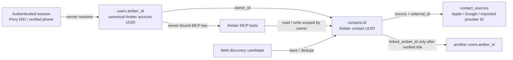

# Amber release and identity map

Audience: CEO, CTO, product, and client developers
Purpose: one stable contract for the Amber mobile app, MCP clients, and future web clients.

## Current verified release snapshot — 2026-10-19

- iOS `main` is `9499998` (`Bump iOS TestFlight build to 14`); Sagar-main `3ac933f` and UI merge `8d5f9df` are ancestors. TestFlight build 14 was built from `9499998`. Mobile `verify` completed with all 21 checks passing; mobile tests passed 584/584, and typecheck and lint passed.
- Backend GitHub `main` and the production `/status` runtime both report commit `6031655` (`Name people from their addresses, spread the graph, stop the markdown`); Cloud SQL is healthy and the schema is current. The full suite passes 2,298 tests, with 45 skipped and 0 failed; backend typecheck and undefined-reference check passed.
- App Store Connect build `1.0.1 (14)` (`aaf73e4f-4f52-4f69-8476-ce9b09c1c867`) was uploaded from EAS build `055ccf92-3f2b-4369-bb0f-aee1509f87df` and assigned to Amber Internal Beta. ASC reports `VALID`. It was not submitted for external beta review. It excludes Kyber by request.
- Expo app owner is `amber-intelligence`; project ID is `65b9b69f-7b1a-4915-9309-42a1069869e8`. The signed-in Expo account has Admin access.
- Production route smoke checks return `401` without a session for Profile, PeopleRank, discovery, Clay, and circles. This confirms registration and authentication gates, not signed-in feature success.
- Production Cloud SQL health and route registration are verified. Signed-in acceptance for onboarding, Profile, PeopleRank, people/place discovery, and Clay is still required before describing the demo as fully live. The booted Simulator is on build 11 and does not verify TestFlight build 14; install `1.0.1 (14)` from TestFlight on a device.
- The newest production OTA is group `4fbda0f8-0929-490c-9084-0639e2b15b4e`, built from iOS `main` at `9499998` with runtime `1.0.1-sagar-beta`, matching build 14.
- The Kyber API host mismatch is fixed on main in `c4d8ab6`; build 14 still excludes the extension.
- The shared Clay public API integration is separate from generic per-user Clay provider enrichment. The latter's test-account credential and a sourced result are not verified. Never put either key in the app or this document.
- EAS auto-submit was unavailable because the Expo project has no App Store Connect API key configured. Build 14 was uploaded using the authenticated ASC CLI.

Older entries in this file are dated implementation records; the snapshot above is the current release and verification status.

## The IDs are different on purpose

| Identifier | What it identifies | Rules for clients |
| --- | --- | --- |
| Session subject / phone claim | The authenticated login presented to Amber | Send the session. Do not use it as a contact ID or let the client pick an account owner. |
| `users.amber_id` | The canonical Amber account and tenant owner (UUID) | The API resolves it from authenticated identity. This is the stable owner key for the dataset. |
| `contacts.id` | One person card within that owner's rolodex (UUID) | Keep this as the person ID in app routes, PeopleRank citations, notes, and MCP responses. Every lookup also checks the owner. |
| `contact_sources.source` + `external_id` | A provider's identifier for an imported record | Keep as provenance and dedupe input. It never replaces `contacts.id`. |
| `contacts.linked_amber_id` | A linked Amber member, when the server has verified the link | Do not infer membership or verification from an imported name, email, or phone. |
| Discovery job / provider candidate ID | A search request or a not-yet-saved provider result | Treat as temporary. A saved result is resolved/upserted and then uses the returned `contacts.id`. |
| Personal MCP API key | A revocable credential bound to one owner | Keep it secret; the owner is resolved server-side. Never send an owner ID to override the key's scope. |

Imported contacts can be people who have never joined Amber. Account identity and contact identity are separate; an imported card does not become a verified Amber member. This preserves the existing human-network foundation and avoids adding a second identity system.

## Request and data flow

1. The client sends the signed-in session to an authenticated `/v1/me/...` route.
2. Amber resolves the session subject or verified phone to `users.amber_id` on the server.
3. Reads and writes scope rows by that owner. A contact operation uses both `contacts.id` and the owner boundary.
4. Imported data keeps source provenance and provider IDs. Upserts deduplicate; the provider ID is not promoted to Amber's internal ID.
5. PeopleRank, discovery, enrichment, notes, and future web views reuse these routes and IDs. A new client may add views, but should not create a parallel person/account table or invent IDs.

## MCP contract

`POST /mcp` is authenticated by a user-issued MCP key (Bearer token or `x-api-key`). The key is purpose-bound, can be revoked, and resolves to one owner. Available tools are `get_dashboard_url`, `people_rank`, `search_people`, `search_plans`, `upsert_contact`, `bulk_upsert_contacts`, `get_contact`, and `add_contact_note`. Those tools provide scoped search and reviewed CRM actions, not unrestricted SQL or a raw table export. The UI reveals a new key once; configure the MCP client with the production server URL shown in Amber and store the key in that client's secret store.

The future web app should call Amber ID's authenticated API with the same session and typed request/response shapes. MCP is an agent-facing interface to the same owner-scoped records, not a second source of truth.

## Data providers and infrastructure

- **GCP / Cloud SQL:** the Railway `amber-id` service reads its configured GCP service-account credential and connects to Cloud SQL. Production `/status` currently reports a healthy database, current schema, and zero pending migrations. No credential values belong in client code, logs, or this document.
- **Clay search:** mobile Clay search and field enrichment use the server's shared Clay public API key and async routines.
- **Clay contact enrichment:** the generic contact-enrichment provider path can use a per-user `CLAY_API_KEY` saved server-side, then an app-level key, then its fallback. This path is distinct from shared-key mobile Clay search/field enrichment. The signed-in user's per-user key and a sourced result have not been verified, so do not treat it as release-proven.
- **Mobile source connectors:** Apple Contacts and Google are the available direct connectors. Other catalog entries are export/manual or coming soon; listing a provider in the UI is not proof of an OAuth or sync integration.
- **iMessage:** Amber does not import a user's Messages history and has no Messages extension. OTP or notification-channel behavior is separate. Kyber may be used from the Messages text field, but iOS does not let a keyboard read the existing thread.

## Demo acceptance sequence

1. Sign in and finish onboarding. Confirm the Profile tab opens and its source list can retry cleanly.
2. Import Apple Contacts; confirm the count and source provenance appear. Connect Google only when the demo account is ready for its disclosed OAuth permissions.
3. Run PeopleRank and confirm ranked people link to Amber contact cards. Search a person, then search a place with an explicit city; saving a result must produce/reuse an Amber contact or plan record rather than expose a provider ID as the Amber ID.
4. Run Clay search/field enrichment, then run generic enrichment on an existing test contact. Confirm the response includes sourced fields and provenance; keep the generic per-user key path marked unverified until this succeeds.
5. In Profile, create an MCP key, connect a client to `/mcp`, and demonstrate `people_rank`, `search_people`, `search_plans`, `get_contact`, and a reviewed note write. Revoke the key afterward if it was for a temporary demo.
6. Kyber is excluded from the current TestFlight build. For a later Kyber build, first merge the native API-host fix, provision the extension, install that build, enable Kyber in iOS Settings, grant Full Access, and demonstrate Ask, People, Plans, and Split in a text field. Use a Messages compose field only to demonstrate insertion; do not imply that the keyboard reads the conversation.
7. Demonstrate the current iMessage channel behavior separately from archive import. Do not promise an iMessage history connector.

## Release gates

- Backend routes for PeopleRank, discovery, Clay, profile, and MCP are mounted in production; unauthenticated smoke requests receive the expected auth response rather than a route 404. Production Cloud SQL health is current.
- Backend suite on current `main` commit `e1cde80`: 2,269 passed, 0 failed, 45 skipped. Mobile verification: all 21 checks passed on iOS release commit `7353d95`; mobile tests passed 584/584. These source checks do not replace the authenticated feature acceptance above. The optional backend `npm run audit` currently reports three PostgreSQL functions as missing tables; those functions are created by migrations, making this a static scanner false positive rather than a production schema issue.
- A full simulator compile is required for the app and extension. Store signing must use the beta app bundle `com.joinrytual.amber.beta` and, only for a later Kyber build, its nested extension bundle `com.joinrytual.amber.beta.kyber`.
- Before a Kyber TestFlight upload, Apple/EAS must have the extension App ID and App Store profile, and both app and extension profiles must permit the shared keychain group. Build 13 is the current internal TestFlight release and does not contain Kyber.
- Confirm PeopleRank and both Clay paths with the signed-in demo account before calling the demo fully live. Do not put provider secrets in the mobile bundle.
